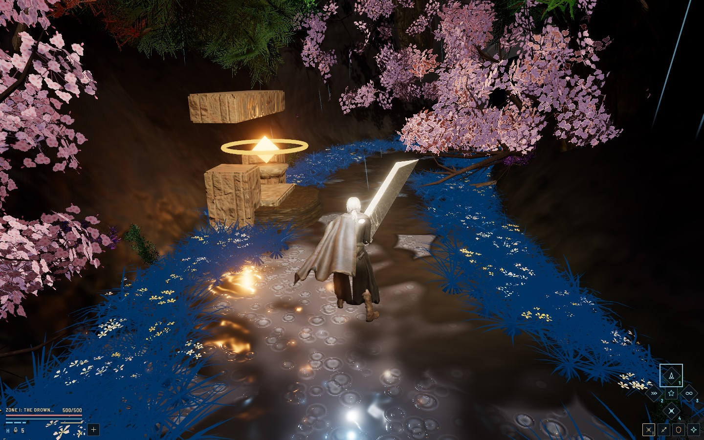
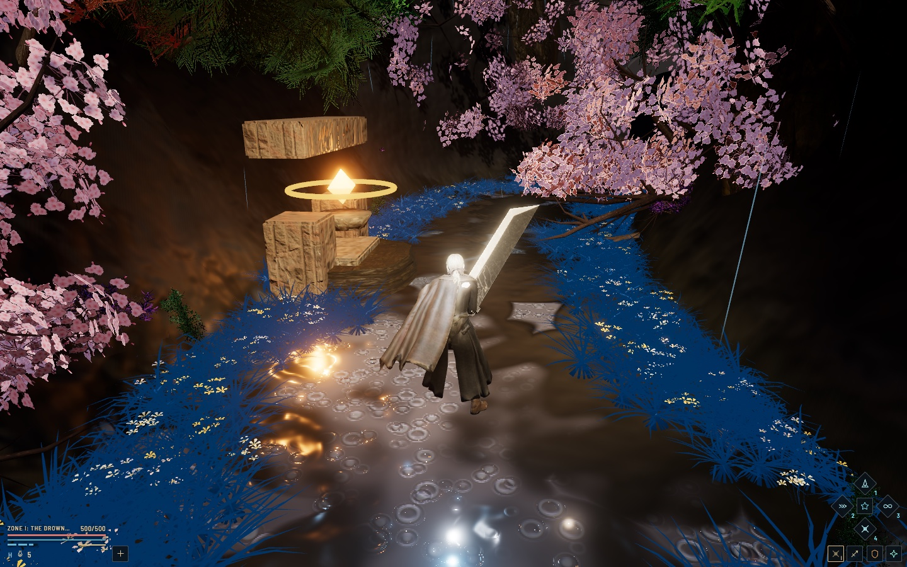
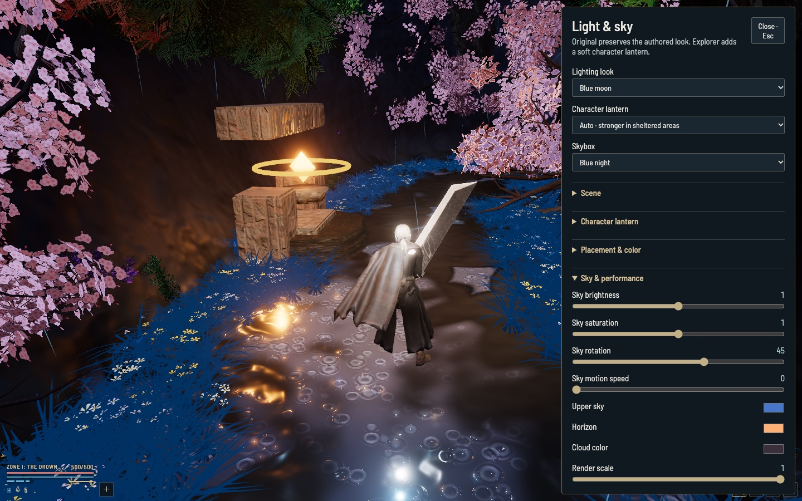
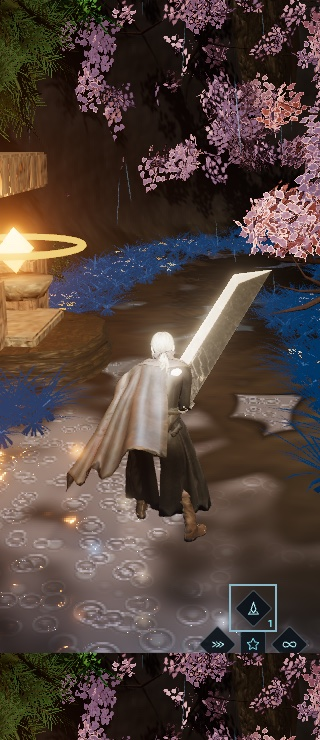

# Reincarnation: The Serpent's Spine

**A WebGPU soulslike action RPG that runs in the browser.** Procedural arterial corridor, nine
chapters, five vessels, twenty weapons and a full TSL post-processing pipeline — built with
[three.js](https://threejs.org/) WebGPU, TSL and Vite.

[](LICENSE)
[](ASSETS.md)
[](https://threejs.org/)



## Play it

Requirements: **Node.js 20+**, a recent WebGPU-capable browser (Chrome/Edge 121+, Safari 18+), and a
GPU. Without WebGPU the game falls back to WebGL2, with reduced effects.

```bash
git clone https://github.com/xirtus/reincarnation.git
cd reincarnation
npm install
npm run dev
```

Open **http://127.0.0.1:5199/**.

The first load compiles the shaders for the entire world before play begins; on slower GPUs this can
take a minute or more. The loading bar reports the stage.

The tracked files total about 365 MB because the optimized art bundle is included, so the reference build
runs without any external asset library. See [Assets and licensing](#assets-and-licensing).

For a production build:

```bash
npm run build
npm run preview
```

## What is it?

Reincarnation is a third-person action RPG in the shape of a soulslike. You descend the **Serpent's
Spine**, a single continuous arterial corridor that folds back on itself through five biomes, then
carry the same character through nine chapter realms — sakura gorge, crimson autumn, frost spire,
abyssal caldera, the necropolis of Khufu-Ra, Babylon, the Norse fjords, Atlantis and the sacred
island of Athenaion.

Everything is real-time: procedural stonework and terrain, a 44-bone retargeting animation store,
weapon trails, volumetric fire, water, weather, and a diegetic HUD.

### Features

- **Five interconnected zones** along the Serpent's Spine: the Drowned Threshold, the Twin
  Courtyards, the Serpent's Ascent, the Mirror Basin and the Sanctum of Tartarus.
- **Nine chapter realms** with per-chapter enemy rosters, boss phases and scaling.
- **Five playable vessels** with distinct rigs and default loadouts.
- **Twenty weapons** across greatsword, katana, blade, staff and baton styles, each with its own
  reach, poise, element and weapon arts.
- **Ten grimoire spells**, from the Serpent Tide Phoenix to Crystallized Venom Surge.
- **Soulslike combat**: stamina, poise, guard, parry, backstep, Mirage dodge, jump attacks, rising
  undercuts, lock-on, weapon skills, Limit Break and heal gourds.
- **Three difficulty profiles** with exact, tested multipliers.
- **WebGPU + TSL rendering**: ACES tone mapping, bloom pipeline, volumetric fire plumes, god rays,
  rain, water reflections and a pooled local-light system.
- **A live lighting workbench** with authored looks, sky presets and per-control overrides.
- **A diegetic HUD and trail map** that stays readable down to small viewports.

## Screenshots

| | |
| --- | --- |
|  |  |
| **Twin crests & weapon arts.** The HUD keeps skill stacks in cinema-safe letterbox bars. | **Light & sky workbench.** Authored looks, lantern behaviour, skybox and render scale, live. |

<p align="center">
  
  <br>
  <em>The same HUD on a 320 px-wide viewport.</em>
</p>

## Controls

| Input | Action |
| --- | --- |
| `W` `A` `S` `D` / arrows | Move |
| Mouse | Look (click the canvas to lock the pointer) |
| Left mouse | Light attack (hold `Shift` for the sprinting variant) |
| Right mouse | Guard |
| Middle mouse / `G` | Lock on |
| `Shift` tap / `L` / `Alt` | Mirage dodge |
| `Shift` hold | Sprint |
| `Space` | Jump |
| `Ctrl` | Crouch |
| `Tab` / `X` | Toggle stance |
| `J` / `U` | Light / heavy attack |
| `R` / `V` / `C` / `B` / `Q` | Rising undercut / piercing thrust / guard break / backhand / leaping smash |
| `K` | Guard (keyboard) |
| `T` / `Y` / `N` | Arcane combo / cast grimoire / cycle spell |
| `F` or `1`–`4` | Weapon skills |
| `5` / `I` | Limit Break: Cross-Slash |
| `H` | Heal gourd |
| `E` | Rest at the nearest shrine, or take the ascension portal |
| `Z` / `P` | Cycle weapon / vessel |
| `M` | Trail map |
| `O` | Light & sky workbench |
| `Esc` | Pause / close dialog |
| `` ` `` | Release the action cursor |

<details>
<summary>Teleport and debug shortcuts</summary>

| Input | Destination |
| --- | --- |
| `Alt`+`1`–`5` / `F1`–`F5` | Shrines 1–5 |
| `6` | Sunken Tidal Hollow (Zone II branch) |
| `7` / `F6` | Next chapter |
| `8` / `F7` | Egyptian vista |
| `?debug` | Adds the debug HUD |

</details>

## Development

```bash
npm test           # unit tests: difficulty, lighting, world preparation
npm run test:browser   # Playwright presentation check (needs a browser)
npm run dev        # Vite dev server on 127.0.0.1:5199
npm run build      # production build into dist/
```

The browser check expects a Playwright Chromium installation. Set `REINCARNATION_BROWSER` to use a
specific Chrome/Chromium executable and `REINCARNATION_URL` to point at a running server.

### Project layout

```
index.html                 markup and the entire HUD/shell stylesheet
src/main.js                bootstrap, input, camera and render loop
src/combat/                combat engine, weapons, spells, bosses, difficulty
src/anim/                  Anima rig, retargeting, animation store, weapons
src/world/                 Serpent's Spine topology, kitbash world, biomes
src/athenaion/             procedural Athenaion island, city, terrain, water
src/render/                TSL shaders, lighting, local lights, scene prep
src/ui/                    HUD, trail map, fonts
src/vendor/pigaloo/        shared lighting presentation modules
public/                    runtime art bundle (not GPL — see ASSETS.md)
tests/                     node:test unit tests
scripts/                   browser checks, capture and bake tools
```

## Assets and licensing

**Code: [GPL-3.0-only](LICENSE). Art: not GPL.**

GPL-3.0 was chosen over GPL-2.0 for its explicit patent grant and compatibility with modern
Apache-2.0 tooling; the code is not tied to GPL-2.0-only components.

The art in `public/` and `public/assets/` is fan-made, heavily reworked and optimized for this project. It
is aggregated with the code, remains the property of its respective creators, and is **not** covered
by the GPL. Do not extract or reuse it separately. The full breakdown is in
[`ASSETS.md`](ASSETS.md); third-party software and credits are in [`THIRD_PARTY.md`](THIRD_PARTY.md).

If you are a rights holder and would like an asset removed, open an issue and it will be handled
promptly.

This is an independent fan project, not affiliated with FromSoftware, Bandai Namco, Square Enix,
Adobe, or any other rights holder.

## Credits

Built by [Andreas Xirtus](https://github.com/xirtus). Thanks to the three.js community for the
WebGPU/TSL renderer, and to Poly Haven for CC0 texture references.

---

If you build something with the engine, a link back is appreciated but not required by the license.
